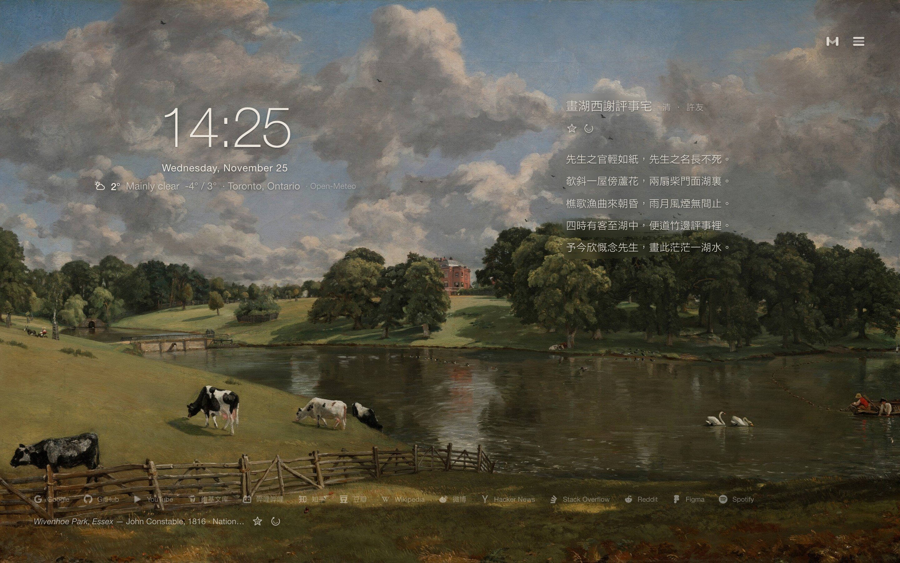
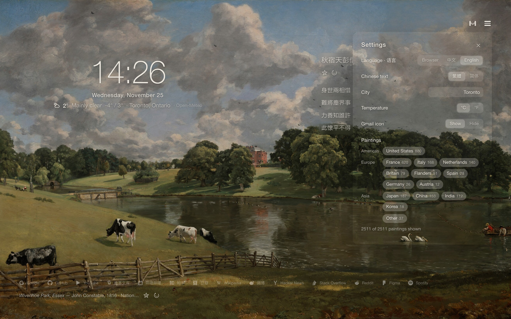

# Art & Verse

[中文](README.zh-CN.md)

A Chrome new tab page with public-domain paintings and classical Chinese texts.

## Install

1. Download and unzip this repository.
2. Open `chrome://extensions`, turn on **Developer mode**, click **Load unpacked** and choose the folder.

Starring a painting or a text saves it to `Downloads/New Tab Favorites/`; un-starring deletes it.

## Permissions

| Permission | Used for |
|---|---|
| `topSites` | Most visited sites |
| `favicon` | Their icons |
| `storage` | Settings and cache |
| `downloads` | Favorites |

## Sources

- Paintings: [Art Institute of Chicago](https://api.artic.edu/docs/), [Cleveland Museum of Art](https://openaccess-api.clevelandart.org/), [National Gallery of Art](https://github.com/NationalGalleryOfArt/opendata) (CC0)
- Texts: [Chinese Wikisource](https://zh.wikisource.org/) (CC BY-SA 4.0)
- Weather: [Open-Meteo](https://open-meteo.com/) (CC BY 4.0)

`data/artworks.json` is built by `python3 tools/build_artworks.py` (needs Pillow).

## License

MIT
