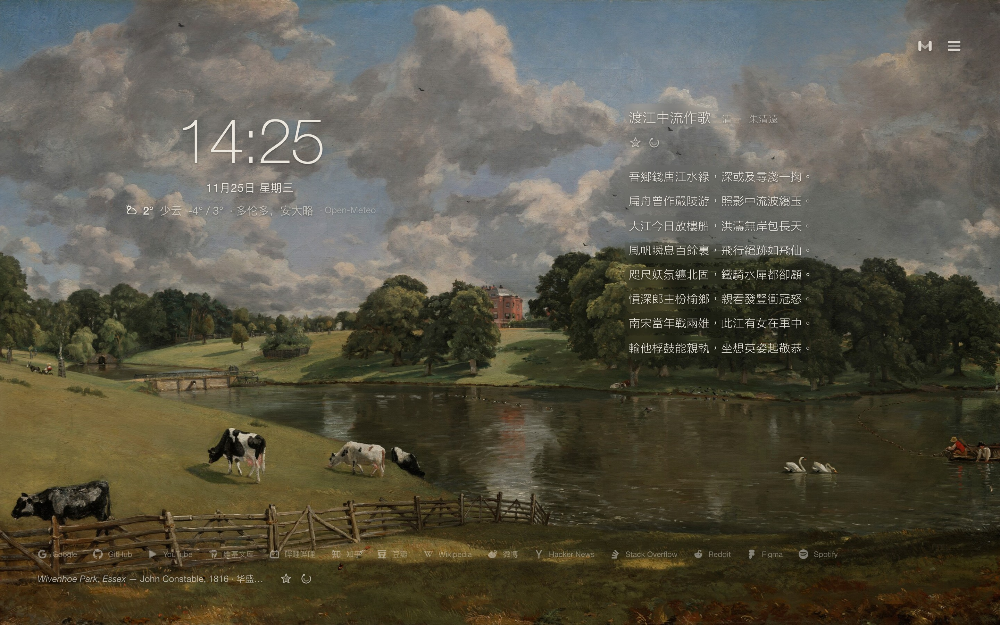
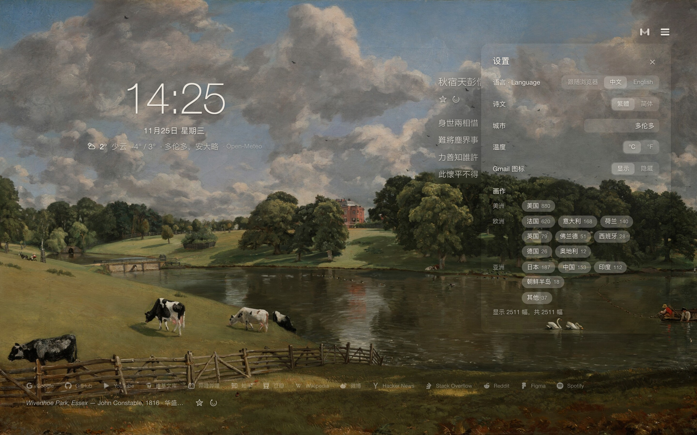

# Art & Verse

[English](README.md)

Chrome 新标签页：公版名画和古诗文。

## 安装

1. 下载这个仓库并解压。
2. 打开 `chrome://extensions`，打开「开发者模式」，点「加载已解压的扩展程序」，选这个文件夹。

点星号收藏的画和诗文存在「下载」文件夹的 `新标签页收藏/`；取消收藏会删掉文件。

## 权限

| 权限 | 用途 |
|---|---|
| `topSites` | 常访问的网站 |
| `favicon` | 网站图标 |
| `storage` | 设置和缓存 |
| `downloads` | 收藏 |

## 来源

- 画作：[芝加哥艺术博物馆](https://api.artic.edu/docs/)、[克利夫兰艺术博物馆](https://openaccess-api.clevelandart.org/)、[华盛顿国家美术馆](https://github.com/NationalGalleryOfArt/opendata)（CC0）
- 古诗文：[维基文库](https://zh.wikisource.org/)（CC BY-SA 4.0）
- 天气：[Open-Meteo](https://open-meteo.com/)（CC BY 4.0）

`data/artworks.json` 由 `python3 tools/build_artworks.py` 生成（需要 Pillow）。

## 许可证

MIT
